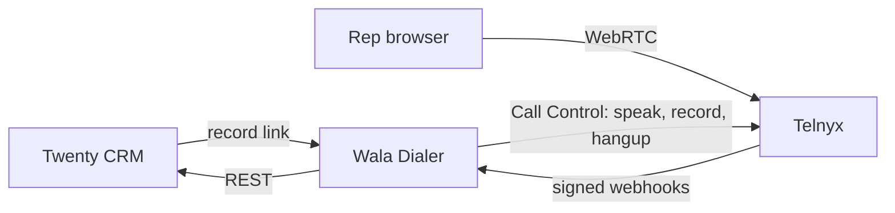

# Wala Dialer

Self-hosted click-to-call for E-Commerce Wala. It replaces the Close dialer seat (about $200 per caller per month) with a browser softphone, Telnyx for the actual calls, and Twenty as the CRM.

Phase 1 is one call at a time from the rep's browser: mute, hold, hang up, a keypad, a timer, a recording notice, calling-hour and do-not-call checks, local-presence caller ID, and a call record written back to Twenty.

The dialer does not modify Twenty's source. It is a separate app in this repo.

## How a call works

1. A rep opens a person, company, or opportunity in Twenty and uses Call, or searches from the dialer home page.
2. The server loads the record from Twenty's REST API (`https://crm.ecommercewala.co/rest/`, `Authorization: Bearer $TWENTY_API_KEY`).
3. Before the browser is allowed to dial, the server checks the number, the internal DNC list, Twenty's do-not-call flags, the prospect's local time, and the caller-ID pool.
4. Telnyx WebRTC places the call from the rep's browser. Telnyx webhooks update answer time, hangup, and the recording URL.
5. The rep picks a disposition. The dialer writes a **Call** record in Twenty and, by default, a timeline note on the same person, company, and opportunity.



## Why the softphone is not inside Twenty

Twenty can show a button on a record. It should not host the phone.

- Front components run in a Web Worker against a partial DOM (Remote DOM). `getUserMedia` and `RTCPeerConnection` are not reliable there.
- Dashboard iframe widgets exist, but they are not a person/company/opportunity button, and a microphone inside a nested iframe is brittle.
- A sidebar item can be an external URL. A pinned command can open a link for the current record.

So this repo ships two pieces:

| Piece | What it does |
| --- | --- |
| This Next.js app | Login, softphone, compliance, webhooks, call log |
| `twenty-app/` | Sidebar link plus a pinned Call action on person, company, and opportunity pages |

The Call action opens `https://dialer.ecommercewala.co/call?personId=<uuid>` (or `companyId` / `opportunityId`) in a normal browser tab. Direct links work even if the Twenty app is not installed yet.

Webhook path, used in the Telnyx connection settings:

`https://dialer.ecommercewala.co/api/webhooks/telnyx`

## Call logging: a custom Call object

Close has a first-class call. A note would bury the duration, disposition, and recording URL in markdown, and nobody could filter "meetings booked this week" or "bad numbers."

The setup script creates a custom **Call** object with relations to person, company, and opportunity. Twenty then exposes `/rest/calls` like any other object. Reps are stored as name and email text, because the API key is a workspace bot and would otherwise look like the owner of every call. `createdBy` on the Twenty row will be that API key. The rep fields are the ones to report on.

A short note is also written so the call shows on the record timeline. Turn that off with `TWENTY_MIRROR_NOTES=false` if the Call relation is enough.

Blocked attempts stay in the dialer's own database. They are not copied into Twenty.

`nextFollowUp` already exists on opportunities. The script warns if it cannot see that field. It does not create a second one unless you pass `--with-next-follow-up`.

## Local run

```bash
cp .env.example .env
docker compose up --build
```

The app listens on [http://localhost:3010](http://localhost:3010) so it can sit beside Twenty, which often already uses port 3000.

`docker-compose.yml` turns on mock Twenty data and mock telephony so the UI works with no API keys. Sign in with developer login as `admin@ecommercewala.co` (that address is the admin in the compose file) or any other `@ecommercewala.co` address for a rep. Try Jordan Lee, Sam Patel, Riley Chen, Alex Nguyen (do not call), and Northwind Outfitters.

Developer login must be off on any host that is reachable from the internet.

Without Docker, for tests only:

```bash
npm install
npm test
```

## Production layout

Run this Compose stack on the same server as Twenty, behind TLS. Caddy example:

```caddy
dialer.ecommercewala.co {
  reverse_proxy localhost:3010
}
```

Caddy sends `X-Forwarded-Proto` and `X-Forwarded-Host`. Set `AUTH_URL` and `PUBLIC_APP_URL` to `https://dialer.ecommercewala.co`.

The dialer database is its own Postgres volume. Twenty stays the system of record for completed calls. Back up the dialer database as well: it holds blocked attempts, the caller-ID pool, and the internal DNC list.

```bash
docker compose exec db pg_dump -U dialer dialer > dialer.sql
```

## Environment

See `.env.example`. Secrets stay in the environment. Nothing secret is committed.

| Variable | Purpose |
| --- | --- |
| `AUTH_SECRET` | Session signing. Long random string. |
| `GOOGLE_CLIENT_ID` / `GOOGLE_CLIENT_SECRET` | Workspace login. Redirect URI: `{PUBLIC_APP_URL}/api/auth/callback/google` |
| `ALLOWED_EMAIL_DOMAIN` | Default `ecommercewala.co` |
| `ADMIN_EMAILS` | Comma-separated admins. Aaron's address goes here. |
| `TWENTY_API_KEY` | Settings → Developers → API in Twenty. Read at runtime. |
| `TWENTY_MODE` | `mock` or `live` |
| `TELNYX_API_KEY` | V2 API key |
| `TELNYX_PUBLIC_KEY` | Account public key used to verify webhooks |
| `TELNYX_CONNECTION_ID` | Credential SIP connection id |
| `TELNYX_OUTBOUND_VOICE_PROFILE_ID` | Outbound voice profile attached to that connection |
| `CALLER_ID_NUMBERS` | Optional seed, `+14155552671:CA:415:default:San Francisco` |
| `RECORDING_TWO_PARTY_MODE` | `announce` (default) or `skip` |
| `ALL_PARTY_STATES` | Replaces the default all-party list when set |

`TELEPHONY_MODE=twilio` fails on purpose. `src/lib/telephony/telnyx.ts` defines the provider methods a Twilio adapter would implement (browser token, record, disclosure, hangup). Phase 1 does not speak TwiML.

## Telnyx account steps

Aaron already has an account. The app reads credentials from the environment. It does not create the Telnyx resources itself, because those are account-level and should be reviewed in Mission Control.

1. Finish business verification / KYC. Unverified accounts get weaker STIR/SHAKEN attestation, which is how calls end up marked Spam Likely.
2. Create an **Outbound Voice Profile** whose allowed destinations include `US`. Put its id in `TELNYX_OUTBOUND_VOICE_PROFILE_ID`.
   ```http
   POST /v2/outbound_voice_profiles
   { "name": "wala-dialer", "whitelisted_destinations": ["US"] }
   ```
3. Create one **Credential Connection** (SIP), not one connection per rep. This is the parent for short-lived telephony credentials the browser uses.
   ```http
   POST /v2/credential_connections
   {
     "active": true,
     "user_name": "wala-dialer",
     "password": "<long random password>",
     "connection_name": "wala-dialer",
     "anchorsite_override": "Latency",
     "webhook_event_url": "https://dialer.ecommercewala.co/api/webhooks/telnyx",
     "webhook_api_version": "2",
     "outbound": { "outbound_voice_profile_id": "<ovp id>" }
   }
   ```
   Put the returned connection id in `TELNYX_CONNECTION_ID`. Do not put the parent SIP password in the browser. On each dial the server creates a telephony credential and returns a short-lived login token.
4. Copy the account **public key** (Mission Control → Keys & Credentials → Public Key) into `TELNYX_PUBLIC_KEY`. Webhooks are rejected without a valid Ed25519 signature. The signed content is `{timestamp}|{raw body}`. Timestamps older than `TELNYX_WEBHOOK_TOLERANCE_SECONDS` (default 300) are rejected.
5. Create a V2 API key and set `TELNYX_API_KEY`.
6. Buy US local numbers. Assign each number to the credential connection (`connection_id`) so it can be used as caller ID. Add them in Admin → Numbers, or seed `CALLER_ID_NUMBERS`.
7. Set `TELEPHONY_MODE=telnyx`, `TWENTY_MODE=live`, `SEED_DEMO_DATA=false`, `AUTH_DEV_LOGIN=false`.

Recording: on answer, the server calls Telnyx Call Control `record_start` (mp3, single channel, no beep), then `speak` with "This call may be recorded for quality and training purposes." Set `TELNYX_DISCLOSURE_AUDIO_URL` to play a file with `playback_start` instead of TTS. The recording URL arrives on `call.recording.saved` and is stored on the call.

Demo 555 numbers are ignored when `TELEPHONY_MODE=telnyx`, even if they are still in the database.

### Caller ID, CNAM, STIR/SHAKEN, branded calling

The pool picks a number in this order: same area code, same state, the number marked default, then `TELNYX_DEFAULT_CALLER_ID`.

These are the hooks for keeping calls off Spam Likely. The dialer records the status. Registration happens in Telnyx, not in this app.

- **STIR/SHAKEN.** Telnyx signs calls from numbers on its network. Complete KYC so attestation stays at A. The number row stores `stirShakenStatus` (default `telnyx_default`).
- **CNAM.** The classic 15-character name, for example `ECOMMERCE WALA`. Set the display name on the number in Admin → Numbers (`cnamDisplayName`) and register that name with Telnyx's CNAM product. `cnamStatus` starts as `unregistered`.
- **Branded caller ID.** A separate Telnyx / First Orion-style product with its own fee. `brandedCallerIdStatus` starts as `not_started`. Turn it on after the first weeks of real traffic, not before the numbers have a clean calling history.
- Spread volume across the pool. One number blasting every cold call gets flagged even with attestation.

`npm run twenty:area-codes` is read-only. It counts area codes on people so you know which numbers to buy first. It pauses between pages because Twenty allows about 100 requests per minute.

## Twenty setup

Do this once, from a machine with the API key. It is not run by deploys, and it was not run against the live CRM from this repo.

```bash
export TWENTY_API_KEY=...
export TWENTY_API_URL=https://crm.ecommercewala.co
npm run twenty:setup           # prints the plan, reads metadata, writes nothing
npm run twenty:setup -- --apply
```

`--apply` creates:

- Call object and its fields (direction, from, to, rep name, rep email, start, end, duration, disposition, notes, recording URL, disclosure played, prospect time zone, dialer call id)
- Relations from Call to person, company, and opportunity
- `doNotCall` boolean on people and companies, if those fields are missing

Dispositions: Connected, Voicemail, No answer, Bad number, Meeting booked, Not interested.

Then install `twenty-app/` (see that folder's README) or paste links manually:

- `https://dialer.ecommercewala.co/call?personId=<id>`
- `https://dialer.ecommercewala.co/call?companyId=<id>`
- `https://dialer.ecommercewala.co/call?opportunityId=<id>`

Opportunity stages are not changed by a call. The rep can set next follow-up on the disposition form. That writes `nextFollowUp`. Stages in use: Lead list, Meeting booked, Show, Proposal sent (no 2nd), Proposal sent (2nd set), Verbal yes, Deal won, No show, Deal cold, No - not for now, No - forever.

## Compliance behavior

This is an engineering control for the rules the team asked for. It is not a legal opinion, and it is not a full TCPA program. There is no national Do Not Call Registry scrub and no wireless-consent check. B2B calls to mobile numbers can still be regulated. Add a registry scrub behind `dncMatch` in `src/lib/compliance/dnc.ts` when counsel wants one.

**Hours.** A call can start only from 8:00am up to, but not including, 9:00pm in the prospect's local time. A call that starts at 8:59pm can continue past 9. The zone comes from the area code. Where one area code covers two zones (for example 812 in Indiana, or 208 in Idaho), the call has to fall inside both windows. Toll-free numbers use the state on the Twenty record, and a state with two zones uses the overlap. If the area code and the Twenty state disagree, the area code wins and the rep sees both. Unknown US area codes, Canadian numbers, and non-US Caribbean numbers are blocked. US territories in the map (Puerto Rico, USVI, Guam, American Samoa, Northern Mariana Islands) can be dialed on their own clocks.

The rep sees the local time and the zone before Dial is enabled. The server checks again when Dial is pressed.

**Do not call.** The dial is blocked when the number is on the internal list, or when the person or the company has `doNotCall` in Twenty. If Twenty is down, the dial is blocked rather than skipping the check. If the field does not exist yet, the rep sees a warning and the internal list still applies.

**Recording.** Default all-party states: CA, CT, FL, IL, MD, MA, MI, MT, NV, NH, OR, PA, WA. The original list was CA, FL, IL, MD, MA, MT, NH, PA, WA. Connecticut, Michigan, Nevada, and Oregon are included because their telephone statutes require all-party consent. Vermont is left off on purpose. Override the whole list with `ALL_PARTY_STATES`.

- `announce` (default): speak the notice to both parties and record, including the notice.
- `skip`: do not record in an all-party state. The rep sees that before dialing.
- One-party states also get the spoken notice unless `RECORDING_ANNOUNCE_IN_ONE_PARTY=false`.

## Tests

```bash
npm test
npm run typecheck
```

Covered: calling hours including daylight saving and Arizona, area-code zones versus UTC, DNC formatting, Twenty DNC flags, recording modes, caller-ID matching, Twenty payload mapping and idempotent sync, the setup plan, webhook signature checks, duplicate events, recording side effects, and the rule that the browser cannot invent a recording URL.

## Cost versus Close

Close, as priced for this team: 10 callers × $200 = **$2,000 per month**, before usage.

Telnyx list prices used here (check Mission Control before buying; taxes and passthrough are extra):

| Line | List rate |
| --- | --- |
| US local outbound SIP | from $0.005 / min |
| Voice API | $0.002 / min |
| Browser / WebRTC | $0.002 / min |
| Call recording | $0.002 / min |
| Recording storage | $0 |
| US local number | $1.00 / month |

Telnyx's own comparison table shows about **$0.007 / min** outbound (SIP plus one interface fee). If the Voice API fee and the browser fee are both billed on top of SIP, a recorded WebRTC minute is **$0.011**. Plan with $0.011 and treat $0.009 (SIP $0.005 + one $0.002 interface fee + recording $0.002) as the lower reading. Sources: [Telnyx Voice API pricing](https://telnyx.com/pricing/voice-api), [SIP trunking](https://telnyx.com/pricing/elastic-sip), and the published US local number rate of $1/month.

Worked example for this team, not a forecast:

- 3 cold callers × 50 attempts × 22 days ≈ 3,300 attempts
- Aaron, Andy, and Gunnar × 12 attempts × 22 days ≈ 800 attempts
- About 20% connect, 5 minutes of talk → about 4,000 talk minutes
- Plan **6,000 minutes** to cover a busier month and voicemail connects
- 30 local numbers to start, bought for the area codes `npm run twenty:area-codes` ranks highest

| | Monthly |
| --- | --- |
| 6,000 min × $0.011 | $66 |
| 30 numbers × $1 | $30 |
| Planning total | about **$100–$150** |
| Heavy month, 20,000 min and 50 numbers | about **$270** |
| Close dialer seats | **$2,000** |

Unanswered calls often bill little or nothing. The $2,000 is the seat price the team is replacing. Branded caller ID, CNAM registration, and taxes are not in the $100–$150 figure.

## What Aaron does to go live

1. Pick the hostname, for example `dialer.ecommercewala.co`, and point it at this server with TLS.
2. Set a real `AUTH_SECRET` and a real Postgres password. The Compose file's database password is only for a local demo. Set `AUTH_DEV_LOGIN=false` and `SEED_DEMO_DATA=false`.
3. Create a Google OAuth client restricted to the `ecommercewala.co` workspace. Redirect URI: `https://dialer.ecommercewala.co/api/auth/callback/google`. Put the client id and secret in the environment.
4. Put admin addresses in `ADMIN_EMAILS`.
5. In Twenty, create an API key and set `TWENTY_API_KEY`. Run `npm run twenty:setup`, read the plan, then `npm run twenty:setup -- --apply`.
6. Edit `twenty-app/src/dialer-url.ts` and install that app with `twenty app dev` or `twenty app apply`. Confirm the Call button on a person.
7. In Telnyx: finish KYC, create the outbound voice profile (US only), create the credential connection with the webhook URL above, copy the API key, public key, connection id, and voice profile id into the environment.
8. Run `npm run twenty:area-codes` and buy the top US local numbers. Assign them to the credential connection. Add them under Admin → Numbers, one of them marked default. Register CNAM as `ECOMMERCE WALA` or the name counsel prefers. Leave branded caller ID for a later week.
9. Set `TELEPHONY_MODE=telnyx` and `TWENTY_MODE=live`. `docker compose up --build`.
10. Place a test call to a team mobile in a one-party state and one in California or Florida. Confirm the notice is audible, the recording URL lands on the call, and the Twenty Call row plus timeline note exist.
11. Deactivate any DEMO numbers if they are still listed.

## Phase 2 — power dialer and voicemail drop

The compliance gate, caller-ID pool, and Call object stay. Phase 2 adds a queue instead of one click per number.

- Build lists from Twenty opportunities in **Lead list**, one rep at a time. Power dialing here means the rep is on the line when a person answers. Unattended autodialing is a different TCPA problem and is out of scope.
- Start at one live call per rep, then a small preview buffer (the next call starts ringing as the rep dispositions). Do not jump to a predictive ratio.
- Use Telnyx answering-machine detection (`call.machine.detection.ended`). Standard detection is about $0.002 per call and premium about $0.0065. On a machine, play a pre-recorded drop with `playback_start` and hang up. The disposition is Voicemail without the rep talking.
- Store drops as audio files the rep or admin uploads. The same recording-consent rule applies: no drop, and no recording, in an all-party state when the mode is `skip`. A drop that includes the notice is the `announce` path.
- Keypad dispositions so the rep is not mousing a form between dials.
- Pacing and a daily cap per caller ID, so one number does not absorb the whole cold-call volume.

## Phase 3 — AI summaries

After `call.recording.saved`, fetch the recording and transcribe it. Telnyx already prices speech-to-text (their own engine or Deepgram) on the same voice account, which avoids shipping audio to a second vendor on day one.

- Write a summary, next step, and objections onto the Call record and into the timeline note.
- Suggest a `nextFollowUp` date. Do not change the opportunity stage until a rep confirms it. Stage names are a sales process, not something a model should advance from "connected."
- Keep the recording URL. The summary is an extra field, not a replacement for the audio.
- Budget roughly $0.005–$0.02 per transcribed minute on top of the $0.011 telephony figure, depending on the engine. A 6,000-minute month of transcription is tens of dollars, not another Close seat.

## Repo map

| Path | Role |
| --- | --- |
| `src/lib/compliance` | Hours, area codes, DNC, recording decision |
| `src/lib/caller-id` | Local-presence selection |
| `src/lib/twenty` | REST client, mock CRM, sync, setup plan |
| `src/lib/telephony` | Telnyx commands, webhook signatures, Twilio stub |
| `src/app` | Login, softphone, admin call log |
| `twenty-app` | Twenty Call button and sidebar link |
| `scripts/twenty-setup.ts` | Schema changes Aaron runs |
| `scripts/area-code-report.ts` | Read-only number buying report |
